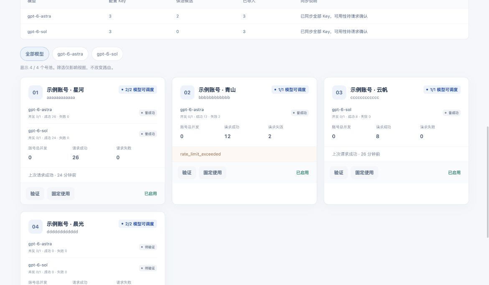

# Pool Router

[简体中文](README.md) | **English**

**Pool Router connects Codex to the account pool configured in BiWrite and shows the account, model, retries, and usage for each request locally.** The current release is **1.0.0**, the Rust edition of the `codex-wiretap` repository; its executable is `pool-router`. The desktop launcher opens a browser dashboard, while a local background process forwards requests.

| Your computer | Download and install |
| --- | --- |
| Apple Silicon Mac, macOS 11 or later | [Download PoolRouter-macOS-arm64.dmg](https://github.com/qzkinhit/codex-wiretap/releases/latest/download/PoolRouter-macOS-arm64.dmg) |
| Windows 10 / 11, x64 | [Download PoolRouter-Windows-x64-Setup.exe](https://github.com/qzkinhit/codex-wiretap/releases/latest/download/PoolRouter-Windows-x64-Setup.exe) |

[All releases and release notes](https://github.com/qzkinhit/codex-wiretap/releases) · [BiWrite repository and installation instructions](https://github.com/zzccppp/biwrite) · [Historical Python implementation](legacy/python/)

The default workflow needs Codex, BiWrite, and an accessible Responses upstream service with your own keys.

| Application | Responsibility |
| --- | --- |
| Codex | Sends your conversation and coding requests. |
| [BiWrite](https://github.com/zzccppp/biwrite) | Stores upstream addresses, models, and keys; runs keep-alive and maintains candidates. |
| Pool Router | Reads candidates, schedules requests by account and model, and displays routing and request records. |

The default request path is **Codex → Pool Router → upstream service**. BiWrite supplies the account source; individual requests do not pass through it. CC Switch is not required for this workflow. Pool Router does not supply upstream accounts or keys.



The screenshot uses simulated data and contains no real accounts, keys, or conversations.

## First-time setup

### 1. Download the package for your computer

Use the download table above. The Mac package is for Apple Silicon; the Windows package is for x64. Installing these prebuilt packages requires no Rust, Cargo, or Python.

**macOS:** Open the DMG, double-click **`安装.command`**, and wait for installation to finish. It installs a user background service and `~/Applications/Pool Router.app`, then opens the dashboard. Eject the DMG afterward and use the installed app from then on.

**Windows:** Run **`PoolRouter-Windows-x64-Setup.exe`**, complete the per-user installation wizard, and open **Pool Router** from the Start menu. The launcher starts the local process and opens the dashboard. Program files are installed under `%LOCALAPPDATA%\Programs\Pool Router`; configuration and records are stored under `%LOCALAPPDATA%\Pool Router`. The installer offers optional desktop and sign-in startup shortcuts.

Installation itself does not change Codex or CC Switch connection settings. Prepare BiWrite before performing the direct connection step below.

The current release has no publisher code signature, and the macOS DMG has not been notarized by Apple. If macOS blocks the first opening, verify that the download came from this repository, find the corresponding message in System Settings under Privacy & Security, choose Open Anyway, and confirm. Older macOS versions use Security & Privacy in System Preferences. Windows may show an unknown-publisher prompt; verify the download source.

### 2. Prepare your upstream, models, and keys in BiWrite

Install and open BiWrite using its [repository instructions](https://github.com/zzccppp/biwrite), then complete these steps.

1. Configure an OpenAI-compatible **Responses** provider with your upstream Base URL, model ID, and key. Providers configured only for Chat Completions are not imported by this adapter.
2. Enable **local key file storage**, corresponding to `keysInFile = true`, so that keys are saved in BiWrite's `keys.json`. Pool Router does not read the system keychain, and you do not need to copy keys into it again.
3. Run keep-alive for the models you intend to use and wait for BiWrite to save their `keptKeys` candidates. A key admitted for one model is not automatically admitted for another.

The default scope imports only keep-alive candidates and excludes keys ignored or stopped in BiWrite. Candidate membership permits later requests; it does not guarantee that a request will succeed now.

### 3. Open Pool Router and check imported accounts

On macOS, open `~/Applications/Pool Router.app`. On Windows, open **Pool Router** from the Start menu. Confirm that the dashboard reports the service as online, then check the following.

1. Use the **BiWrite** source in Routing Settings (`路由设置`). A single eligible upstream address is discovered automatically. If several exist, enter the Base URL you want and save.
2. Find your model in Source Synchronization (`来源同步`) and check its candidate and imported counts. The imported count must be greater than zero for the corresponding account to appear.
3. After running keep-alive in BiWrite, click Sync and Verify Keep-alive (`同步并验证保活`). Pool Router rereads the saved candidates and sends one small real verification request for each account and model. Models with definitive authentication, permission, quota, or model failures leave the candidate pool. Temporary network errors, 429 responses, and timeouts only cause cooldown and do not remove accounts. In all-key scope, the button reads Sync All Keys (`同步全部 Key`) and only rereads configuration without probing every key. A manual sync does not resume paused automatic synchronization.

Start with the default keep-alive candidate scope. **Continuously Sync All Keys (`持续同步全部 Key`) is optional.** It adds non-kept, ignored, and stopped keys at the selected upstream to both the dashboard and routing candidates; it does not verify their availability.

### 4. Connect Codex directly

Click **Connect Codex Directly (`直接接入 Codex`)** at the top right. After success, the button changes to **Check Connection (`检查接入`)**. This step backs up the Codex configuration, selects the local `http://127.0.0.1:10813/v1` provider, and sets the required authentication and Responses options. You do not need to enter the local token manually.

Reopen or reload already-open Codex conversations after the first connection so they use the new configuration. The Check Connection label means the configuration is recognized as directly connected; the next step confirms the actual request path.

### 5. Send a request and verify it in the monitor

Send a short Codex request, such as “Reply only OK.” This is a real upstream request and uses your account quota. Return to **Request Monitor (`请求监控`)**, find the latest record, and check its result and routing label.

Records show the conversation name first and can be searched by **conversation name or ID**. Click the name to open that Codex conversation. Click elsewhere in the row to inspect the requested model, selected account, each attempt's status and error, and usage reported by the upstream. Records without a name fall back to the conversation ID.

Names are read only from `title` or `name` in the local Codex database; conversation bodies are not read. The name cache expires after five seconds and is reread on a subsequent monitor refresh, so renames do not appear immediately. Names are added for display only and are not written to `records.jsonl`. Unavailable names fall back to IDs.

### 6. Confirm which path you are using

Use the record for the request you just sent.

| What you see | What it means |
| --- | --- |
| Check Connection (`检查接入`) button | The current Codex configuration is recognized as directly connected; a new request still needs to confirm that an existing conversation uses it. |
| Pool Routing (`号池调度`) on the new record | This request uses candidates from the current Pool Router source and its routing policy. |
| Legacy Monitoring (`旧方式监控`) on the new record | This request carries an upstream key and uses the compatibility path without selecting an account from the current pool. |
| Allow Legacy Monitoring (`允许旧方式监控`) enabled | Compatibility requests are allowed; this does not establish the route of your current requests. |

For first-time setup, complete the direct workflow above. Read Optional CC Switch Monitoring below only if you intend to keep maintaining keys in CC Switch.

## Daily token usage and estimated cost

Open **用量与花费** (Usage and cost). The four cards show today's cost, today's tokens, the cost over the selected range, and the cache hit ratio. Below them, daily cost and daily tokens appear as two separate charts, because an amount and a token count do not share a scale. Further down, the day is broken out by model, reasoning effort, account and conversation.

The amounts are **estimates, not a bill**. They come from the price table under 价目表与汇率 (Price table and rate), which ships with the published standard-tier prices in US dollars per million tokens. When a relay settles at its own multiplier, either set 结算倍率 (Settlement multiplier) once or edit each model's prices. Saving applies immediately and recomputes the history.

Input is priced in three disjoint parts: ordinary input, cache reads and cache writes. Cache writes cost more than ordinary input, and a missing lifetime split is charged at the cheaper rate, so the figure is a lower bound. Reasoning tokens are already inside the output count and are never charged twice; the panel shows them as a share only. An input above 272K tokens uses the long-context prices. Service tiers apply as multipliers. Hosted tool fees never appear in the usage object, so this is a token cost rather than a total bill.

Requests for which the upstream returned no usage are not counted, and the panel reports how many there were. That happens when a stream breaks early or the upstream fails.

Daily totals live in `usage.json`, apart from the request monitor: the monitor keeps only the most recent requests, while the ledger accumulates per day and keeps about a year. The price table lives in `pricing.json`. Neither is written into the main configuration file, so an older build reading the same configuration is unaffected.

## Check for and install updates

1. Click **Check for Updates (`检查更新`)** at the top of the Pool Router dashboard to view the current version and the latest official GitHub Release.
2. When a newer package is available for your computer, click **Download and Open Installer (`下载并打开安装包`)**. The local service downloads it from this repository’s official Release, verifies its SHA256, and opens it. Do not submit another download while it is running.
3. On macOS, double-click `安装.command` in the opened DMG. On Windows, complete the opened installation wizard. Existing configuration is preserved. Refresh the dashboard after installation to confirm the version. Updating restarts this application, so install after current requests finish.

This checks official Releases; it does not install source changes directly from `main` or silently replace the running application. Equal or older release versions are not offered as downgrades. If no package or reliable checksum is available for the current platform, use the GitHub release-page link in the dialog for instructions. If GitHub cannot be reached, check the network connection and click Check for Updates again.

## Frequently asked questions

### Why are there no accounts, or no accounts for a particular model?

Check that BiWrite uses local key files, that the provider uses Responses, and that its upstream matches the one selected in Pool Router. Then inspect the model's candidate and imported counts. Missing or empty `keptKeys` means the default scope does not import that model; historical `keyThrough` success timestamps cannot substitute for candidates. Run keep-alive for that model in BiWrite and click Sync and Verify Keep-alive (`同步并验证保活`). If candidates exist but none are imported, also check whether keys were ignored, stopped, removed from the declared configuration, or rejected by definitive verification failures.

### Why does the dashboard show every account rather than only keep-alive candidates?

Check whether the scope says All Keys (`全部 Key`). If it does, click **Sync Only Keep-alive Candidates (`仅同步保活候选`)**, then click Sync and Verify Keep-alive (`同步并验证保活`). Existing in-flight requests continue. Verification describes only that request; subsequent proxy requests keep updating success, failure, and cooldown observations.

### Why do unavailable accounts remain after synchronization?

`keptKeys` includes keep-alive and re-entry candidates, and ordinary keep-alive failures may leave keys in that set. `keyThrough` records historical success and may be saved only at hourly intervals. BiWrite does not expose its live in-window state to Pool Router, so manual candidate synchronization independently sends real verification requests instead of relying on historical timestamps.

The dashboard reports successful, removed, and temporarily failed or unfinished checks. Definitive authentication, permission, quota, and unsupported-model failures remove only the affected model and remain excluded during later automatic reads. The next manual sync verifies the complete source again. Temporary 429, 5xx, network, and timeout failures, along with checks that did not finish in this round, retain the account rather than counting as definitive failures. Verification uses account quota, and success does not guarantee continued availability.

### How do I reopen the dashboard after closing the browser?

On macOS, open `~/Applications/Pool Router.app`; on Windows, open **Pool Router** from the Start menu. The browser is the control panel, and closing it does not stop background forwarding. Use the launcher instead of entering the local address manually so that the dashboard receives its required local authentication token.

### How do I tell whether I am still using the old connection method?

Send a new request and inspect its label in Request Monitor. Pool Routing (`号池调度`) identifies the current pool path; Legacy Monitoring (`旧方式监控`) identifies the compatibility path. The Check Connection button describes configuration state, while Allow Legacy Monitoring is a permission switch. Neither replaces evidence from the actual request record. To return to the default pool path, click Connect Codex Directly (or Check Connection if already configured), reopen the conversation as directed, and verify with another request.

### Why is a name missing, or why are there no new monitor records?

If only the name is missing, use the ID. The application looks up explicit conversation IDs in readable local Codex databases; conversations on other devices or missing local indexes may have no name. If the request has no record at all, check that the service is online, recording is enabled, and the sending Codex conversation has loaded the local connection configuration. Only requests passing through the local endpoint are monitored.

## Installation and command-line reference

### Build release packages as a maintainer

These tools are for building release packages from source. Users installing a DMG or EXE do not need to run them. On macOS, run these commands in the repository in order:

```bash
cargo build --release --locked --bin pool-router
python3 scripts/package-release.py --output dist/macos
python3 scripts/macos-package-dmg.py dist/macos/PoolRouter-macOS-arm64.zip dist/macos/PoolRouter-macOS-arm64.dmg
```

On Windows, use PowerShell with Rust and the installer build tools available:

```powershell
./scripts/windows/build.ps1 -ReleaseTag v1.0.0
```

Alternatively, run the **Build Windows installer** GitHub Actions workflow and supply `release_tag`. After creating the release tag, leave `source_ref` empty to build that tag. To build before tagging, explicitly supply the intended commit or branch, such as `main`. The resulting package must correspond to the final release tag; an unchecked branch build is not evidence of a published release.

### ZIP package and DMG reproduction

Every release ships `PoolRouter-macOS-arm64.zip` alongside the DMG. New users should use the DMG. To use the ZIP, extract it and double-click `安装.command`, or run this from its root directory:

```bash
bash scripts/macos-install.sh --no-build
```

The 1.0.0 ZIP installer matches the DMG and generates macOS plist files with the system `plutil`, so it needs no Python; the older v0.1.0 ZIP installer still requires `python3`. A DMG and the ZIP of the same release contain the same executable and dependency licenses. Use the current repository to package a DMG from an existing binary ZIP. **Packaging requires Python 3; installing the DMG does not.**

```bash
python3 scripts/macos-package-dmg.py /path/PoolRouter-macOS-arm64.zip /path/PoolRouter-macOS-arm64.dmg
```

### Windows installation paths

| Item | Location |
| --- | --- |
| Program files and launcher | `%LOCALAPPDATA%\Programs\Pool Router` |
| Configuration, manual accounts, and request records | `%LOCALAPPDATA%\Pool Router` |
| Open the dashboard | Start menu → Pool Router |
| Default BiWrite data directory | `%APPDATA%\app.biwrite.desktop` |

### Build from source

Install a current stable Rust toolchain, Cargo, and a C compiler toolchain. On macOS, build and install with:

```bash
git clone https://github.com/qzkinhit/codex-wiretap.git
cd codex-wiretap
bash scripts/macos-install.sh
```

Installer options are `--no-build`, `--no-open`, and `--no-start`. The last option installs files without starting the service or opening the dashboard. Reinstalling restarts this application's own background service.

To run without installing a background service:

```bash
cargo build --release --locked
./target/release/pool-router init
./target/release/pool-router serve
```

Keep that service running, then open the dashboard from another terminal:

```bash
./target/release/pool-router open
```

All commands accept `--config /absolute/path/config.json`. The `open` command reads the private local token and supplies it to the dashboard through a URL fragment without printing it. Stop a foreground service with `Ctrl+C`.

### macOS installation paths

| Item | Location |
| --- | --- |
| Executable | `~/Library/Application Support/Pool Router/bin/pool-router` |
| Configuration | `~/Library/Application Support/Pool Router/config.json` |
| Manual account store | `~/Library/Application Support/Pool Router/manual-keys.json` |
| Request metadata | `~/Library/Application Support/Pool Router/records.jsonl` |
| Service log | `~/Library/Application Support/Pool Router/logs/service.log` |
| Launcher | `~/Applications/Pool Router.app` |
| Background service | `~/Library/LaunchAgents/local.pool-router.plist` |

Linux and architectures without a prebuilt package can use the command-line build and runtime. The `macos-install.sh` script and LaunchAgent above apply only to macOS.

## Direct Codex connection details

The connection action backs up `~/.codex/config.toml`, adds a separate `pool_router` provider, and selects it as Codex's active provider. It uses the local endpoint, the application's generated local token, and these protocol settings:

```toml
wire_api = "responses"
requires_openai_auth = false
supports_websockets = false
```

Connecting also writes `stream_max_retries`, matching the retry budget in the routing settings so Codex does not fall back to its own default for stream reconnects. The field is deliberately excluded from the connect consistency check, so a value tuned by hand survives a reconnect; it is only filled in when absent. Restoring the connection removes it.

When the configuration has no `[agents]` table, connecting adds subagent defaults: `max_concurrent_threads_per_session = 5` and `default_subagent_reasoning_effort = "high"`. An existing table is never modified, not even to add a missing key. Restoring removes only defaults that were left exactly as written; editing any of them keeps the whole table.

Existing providers and unrelated settings are preserved; `auth.json` is unchanged. The default direct connection does not read or modify the CC Switch database and does not stop CC Switch. If a backup from this application's older integration exists, its own changes are checked and restored before a new backup is created.

Already-open Codex conversations may need to be reopened or reloaded once after initial connection. Send a real request and confirm that it appears in the dashboard. After that, source selection, candidate synchronization, routing policies, and model/reasoning overrides take effect inside the proxy without restarting Codex. In-flight requests retain their selected account and model.

Repeating connection with the same endpoint and token is idempotent. Later edits to managed fields trigger conflict checks instead of being silently overwritten.

## Account source and routing policy

The `source_mode` configuration field determines where accounts come from. The routing policy determines which account handles a request. These are independent settings.

| Account source | Behavior |
| --- | --- |
| `biwrite`, default | Reads BiWrite's local `settings.json` and `keys.json` every 1.5 seconds without copying keys manually. |
| `manual` | Uses only the keys, models, labels, and concurrency limits entered in the dashboard. |

By default, the automatic source imports only `keptKeys` candidates from Responses providers at the selected upstream, excluding ignored or stopped keys. The dashboard’s continuous all-key sync action immediately selects the BiWrite source and enables `biwrite_import_all`. Subsequent automatic reads keep including all keys at that upstream, including keys outside the keep-alive set and keys marked ignored or stopped. This does not create a manual pool. You can switch back to keep-alive candidates at any time. The public default is `false`; imported accounts remain unverified until an actual request provides evidence. The default BiWrite directory is `~/Library/Application Support/app.biwrite.desktop` on macOS and `%APPDATA%\app.biwrite.desktop` on Windows. The adapter requires `keysInFile` to be enabled. It does not read the system keychain or modify BiWrite files.

The dashboard reads key labels from BiWrite’s `keyNames` for account cards and account references in request records. If no usable label exists, it displays an anonymous account identifier. Saved keys are never returned for display.

The source synchronization summary includes every configured model at the selected upstream and its total, keep-alive candidate, and imported key counts, including zeros. In keep-alive-only mode, a model such as Sol with an empty `keptKeys` set is reported as configured with no keep-alive candidates and is not added to schedulable accounts. All-key mode does not depend on the keep-alive candidate count, but import does not establish current availability. Historical success is never treated as real-time health.

The pool view can be filtered by full model ID. Cards retain key labels and show the selected model’s health observations and concurrency. Filtering changes only the view, leaving routing policies, model overrides, and account configuration unchanged.

`keptKeys` is a keep-alive and re-entry candidate set, not an exact assertion that an account is currently admitted. `keyThrough` records historical success and may be persisted only at hourly intervals. The proxy tracks its own observed success, failure, cooldown, and concurrency separately. During normal automatic synchronization, a failed read briefly retains the previous snapshot. Once the last successful read is more than 30 seconds old, new assignments stop until the files become readable again.

The pause control sets `sync_paused = true` and stops only scheduled BiWrite reads. The current pool remains schedulable and does not expire merely because synchronization was deliberately paused. Every application startup reads the current source once to initialize the pool, including when a saved pause is active; subsequent periodic synchronization respects the pause setting. Sync and Verify Keep-alive (`同步并验证保活`) rereads candidates and verifies each account-model pair with at most six concurrent checks, one attempt per check, and a 60-second timeout. Definitive-failure exclusions last for the current process; the next manual verification checks the complete source again. Sync All Keys (`同步全部 Key`) only rereads configuration without probing each key. Neither manual action resumes automatic reads; the resume control restarts scheduled reads. Pause and all-key scope are saved independently; both default to `false`.

The application has no built-in provider address. `upstream_base_url` defaults to `null`, which discovers the unique HTTPS Responses upstream in BiWrite when using the automatic source. If multiple addresses exist, you must specify the desired Base URL in the dashboard; the application does not choose one arbitrarily. An explicit address restricts imports to that upstream. When switching from the automatic source to manual mode without an explicit address, the most recently resolved upstream is saved to `upstream_base_url`. Manual mode then retains its upstream selection if BiWrite is closed or its directory moves. If no previously resolved address is available, an explicit address is required. Starting directly in manual mode requires an explicit `upstream_base_url`; manual mode does not follow changes in BiWrite and rejects forwarding when this address is absent. Only HTTPS public domain names on the default port are accepted, without user information, query parameters, fragments, or other paths. Root and `/v1` paths are normalized to `/v1`.

For manual mode, add accounts before saving the source change. Manual keys are sent to the same selected upstream. Editing the manual list while the automatic source is active does not change the BiWrite pool. Switching to an empty manual pool is rejected. Adding the same key again merges its models; saved keys are not returned in the account list. Manual keys are kept in the private local `manual-keys.json`; automatic-source keys are read into memory only.

| Routing policy | Behavior |
| --- | --- |
| `sticky`, default | Tries to keep a conversation on its previous account. Requests that permit switching may use another candidate if that account becomes unavailable. |
| `random` | Randomly selects an eligible candidate with capacity. |
| `round_robin` | Rotates through eligible candidates with capacity. |
| `pinned` | Uses only the selected account; failures do not trigger a switch to another key. |

An automatically imported BiWrite account can therefore be pinned, while a manually maintained pool can use automatic random or round-robin scheduling.

Concurrency and health are tracked per **key + model**. An Astra failure does not mark Sol as failed for the same key. The default is one in-flight proxy request per key and model, also constrained by the model limit stored in the source. An optional account-wide limit can additionally cap concurrency across models. BiWrite keep-alives and requests from other clients are outside this proxy's counters, so combined upstream traffic can still hit an account limit.

Model and reasoning effort follow Codex by default. Dashboard overrides affect subsequent pool requests only. Requests containing `previous_response_id` preserve the original account and model association and cannot be moved across accounts or overridden to another model.

The account probe sends a fixed `Reply only OK.` request with `low` reasoning effort and no user conversation. Its dialog retains status, timing, requested and declared models, the fixed request, actual visible response text, safe error classifications, usage, and event details. Successful response text can be inspected directly; the dashboard does not invent an “OK” when no visible text was returned. Each account’s latest probe can be reopened from its log action. Results remain in the current page’s memory, disappear on refresh, and are never written to persistent browser storage. A successful probe establishes only that this request succeeded; text and events may be truncated at their display limits.

## Optional CC Switch monitoring

If you prefer changing keys in CC Switch, expand the dashboard's CC Switch compatibility section and enable legacy monitoring. The action changes the upstream URL of **CC Switch's currently selected Codex provider** to the local endpoint and disables WebSocket support for that provider. It does not change its key, model, reasoning effort, or service tier, and does not select a different CC Switch provider.

Continue changing keys in CC Switch afterward. There is no need to copy those keys into Pool Router's manual store. If you select a different CC Switch provider that does not point to this local endpoint, its traffic will not automatically appear in the dashboard.

| Request path | Authentication credential | Behavior |
| --- | --- | --- |
| Codex → Pool Router → upstream provider | The application's local token | `route_mode = "pool"`; uses the selected account source and routing policy. |
| Codex → CC Switch → Pool Router → upstream provider | A supported upstream `sk-` key forwarded by CC Switch | `route_mode = "legacy"`; uses only the key supplied with that request. |

The legacy path uses only the original provider address stored in the private backup created during compatibility integration. Forwarding is rejected if integration is incomplete or the backup is invalid; the application does not guess the destination for the caller’s key. It never selects or falls back to the stored pool. It does not apply dashboard model or reasoning overrides, does not modify the requested `service_tier`, and does not automatically retry or change keys. The upstream request body is forwarded as received, with monitoring parsing kept separate from forwarding. Session recovery, compaction repair, and image compression do not apply to this path.

The integration actions are `POST /api/legacy/connect` and `POST /api/legacy/restore`. Both management endpoints require the local token. Compatibility integration has a separate recovery backup. Restoration reverts only the URL and transport fields managed by this application, preserving keys subsequently changed in CC Switch and other unrelated settings.

`legacy_monitor_enabled` defaults to `true`. It permits requests carrying an upstream key; it does not change the default `biwrite` source or the pool behavior of local-token requests. Disabling it rejects compatibility-key requests while leaving the local-token path available.

Legacy monitoring does not consume pool scheduler slots. If both paths use the same key at once, account for the upstream total concurrency limit. After returning to the original provider, Direct connect can reapply the pool connection while preserving the first backup and later changes to unmanaged settings.

## Protocol, retries, and context

The Rust version supports HTTP/SSE on `POST /v1/responses`, plus `POST /v1/responses/compact` and local `GET /v1/models`. Responses WebSocket, Chat Completions, and arbitrary path forwarding are not supported. Set `supports_websockets = false` in the client. The upstream address is discovered from BiWrite or explicitly selected in routing settings.

The pool path checks both HTTP status and Responses/SSE events. A failure event inside HTTP 200 is not counted as success. Before meaningful output, an explicit retryable rejection or a confirmed failure to establish a connection can select another candidate. Once text, reasoning, or tool-call output appears, the request is not automatically replayed. Transport interruptions with an uncertain outcome are also not retried transparently.

The pool defaults to at most **15 retries**, or **16 attempts including the first request**. The backend setting `max_attempts = 16` includes the first request; the dashboard displays and edits the retry count. Requests created by session recovery or compaction repair count against the same limit. Queueing and the pre-output phase share a 600-second deadline. The upstream response-header timeout is 120 seconds, the first meaningful output deadline is 120 seconds from the start of each attempt, and the stream idle timeout is 180 seconds. The time deadline can therefore expire before all retries are used. Legacy monitoring submits each upstream request once.

The default `first_output_timeout_ms` is `120000`. If a pool request has no `previous_response_id` and has produced no meaningful content, reaching that deadline can release the current attempt and schedule another. SSE heartbeats and status-only events do not count as meaningful content. Once text, reasoning, or tool-call output appears, the request is not automatically replayed. A timeout does not prove that the upstream never executed the request, and more retries do not guarantee success or eliminate an upstream-wide outage.

When a pool client sends `Accept: text/event-stream`, the proxy immediately emits an SSE waiting comment and sends a heartbeat every five seconds while waiting. Comments contain no response ID or model output, so pre-output failover remains possible. Errors after response headers have been sent are returned as SSE `error` events; records retain the actual processing status. Disconnecting the client cancels unfinished waiting and forwarding.

A pool request containing `previous_response_id` must use its recorded original account and model. Each response ID also binds the upstream session mapping actually used for that response, or its original unmodified state. Continuations preserve that state instead of applying a mapping subsequently rebuilt for the same scope. Unknown, expired, or unavailable bindings return an explicit error. Bindings are held in memory and expire after 24 hours by default. Restarting the proxy loses them, so the client may need to resend context. Legacy monitoring forwards the client's continuation fields unchanged and does not substitute an account using pool bindings.

Session recovery is controlled by `session_recovery_enabled` and is enabled by default. Before meaningful output, persistent 429 responses or a 502 explicitly identifying an unavailable bound resource can trigger an upstream session identifier reset for a request without `previous_response_id`, at most once per request. The replacement is scoped to the original conversation, account, model, and upstream, and later matching requests without `previous_response_id` can reuse it. This does not reconstruct omitted history or make `previous_response_id` portable across accounts. A generic 502 does not trigger this recovery; whether a compatible upstream accepts a replacement identifier depends on its implementation.

Compaction repair is controlled by `compaction_repair_enabled` and is enabled by default. Only an HTTP 400 from `/v1/responses/compact` that explicitly identifies incompatible, invalid, or undecryptable encrypted content permits removal of the affected opaque encrypted reasoning or compaction items and one repair retry. Available plaintext, messages, and tool-call relationships are preserved. Ordinary 400 errors and successful responses do not trigger removal. Removing encrypted items can lose context available only through those items, so the client still needs to supply the history required to continue. This is bounded handling of compatible upstream failures, not an official protocol guarantee.

Image compression is controlled by `compress_images` and is disabled by default. When enabled, it processes only inline Base64 PNG/JPEG images in request messages and does not download external image URLs. Eligible images may be reduced to a 2048-pixel longest edge and converted to lossy JPEG, with transparent areas composited onto white. A replacement is used only when it reduces the payload sufficiently. Small images, unsupported formats, animations, images exceeding processing budgets, and decoding failures remain unchanged. Compression can affect small text, fine lines, and other details; keep it disabled when those details must be preserved.

A shared upstream URL does not establish that accounts share server-side conversation state or prompt caches. The amount of context sent depends on Codex and its protocol. Cache hits and transmitting a request body are separate matters; the proxy does not reconstruct omitted history.

## Monitoring and local data

Using conversation UUIDs already present in request records, the monitor reads only `title` or `name` from local Codex databases and adds a nullable `conversation_title` to the API response. It uses `CODEX_HOME` when set, otherwise the current user’s `.codex` directory, including `USERPROFILE` on Windows. Both found and missing titles are cached for five seconds and refreshed on a later monitor query. Conversation bodies are not read, and names are not added to the request JSONL. Display and search retain the original ID when no name is available.

Only requests **passing through the local endpoint** are monitored. This is not system-wide packet capture or HTTPS interception. The dashboard keeps the latest 1,000 allowlisted metadata records by default. Recording can be paused while forwarding continues.

Records also include `gateway_actions`, the actual request body size sent in the last upstream attempt as `upstream_request_bytes`, and the wait for meaningful model output as `first_output_ms`. The dashboard distinguishes session resets and reuse, compaction repair, image compression, and timeout retries. It never substitutes SSE heartbeats, first-byte timing, or total request duration for meaningful output timing; missing values remain unknown.

Records include `route_mode`, an anonymous account identifier, recognizable conversation UUIDs, requested and server-declared model/reasoning values, request and response `service_tier`, status and failure classifications, attempt count, timing, byte counts, and upstream-reported token, cache, and reasoning-token usage. The effective model and reasoning effort after pool overrides are shown separately. The dashboard maps anonymous account identifiers to key labels from the current source. Missing upstream fields remain unknown rather than being inferred as confirmed values.

The dashboard groups `fast` and `priority` together for service-tier viewing while retaining the original request and response values. These fields describe request parameters or server declarations; they do not prove the actual backend model, execution tier, or final billing.

Ordinary gateway logs retain only allowlisted metadata and bounded, redacted per-attempt error messages in `AttemptRecord.error_message`. They do not store complete requests or successful response bodies. Error summaries explain individual failures; missing messages remain unknown, and complete upstream error responses are not stored. Summaries contain upstream diagnostic text and should still be reviewed before sharing. Limited text from fixed probes is used only in the current page’s probe details, separately from ordinary gateway logs. BiWrite keys are read into memory, manual keys use a private file, and a compatibility key is used only to forward its request. Private configuration contains the local access token, and recovery backups may contain credentials from previous configuration. These files should not be included in source archives, screenshots, or diagnostic bundles. They are created with `0600` permissions on macOS and Linux.

The service binds only to loopback and checks Host and browser Origin. Management endpoints always require the local token. Compatibility upstream keys are accepted only by model-forwarding endpoints and cannot authorize administration.

## Maintenance, restoration, and removal

To update, rerun the installer for your operating system. On Windows, uninstall Pool Router from the system application list or the Start menu. The Windows uninstaller first restores connection settings managed by this application. Conflicts in managed fields abort uninstallation and preserve the configuration for resolution. User data is retained by default.

The commands and LaunchAgent operations below apply to macOS. Inspect sanitized status or reopen the dashboard:

```bash
"$HOME/Library/Application Support/Pool Router/bin/pool-router" status
"$HOME/Library/Application Support/Pool Router/bin/pool-router" open
```

Rerun the installer to update. Restarting the proxy can affect in-flight requests and in-memory continuation bindings, so update after current requests finish. Ordinary dashboard changes do not require restarting the service or Codex.

If Codex or CC Switch has been connected, restore the connection before disabling or removing the service:

```bash
"$HOME/Library/Application Support/Pool Router/bin/pool-router" restore
```

This checks and restores pending direct and compatibility-monitor integrations managed by the application. To restore only CC Switch monitoring, use its dashboard restore button. Unrelated later edits are preserved; conflicting changes to managed fields stop restoration and retain the backup. You may need to reopen Codex conversations afterward and verify the restored request path.

Disable the macOS background service without removing files:

```bash
launchctl bootout "gui/$(id -u)/local.pool-router"
```

Start it again:

```bash
launchctl bootstrap "gui/$(id -u)" "$HOME/Library/LaunchAgents/local.pool-router.plist"
```

Remove the background service and launcher:

```bash
bash "$HOME/Library/Application Support/Pool Router/uninstall.sh"
```

The macOS uninstallation script does not stop CC Switch or other wiretap services. Configuration, manual keys, logs, and archived recovery backups are retained by default. After verifying restoration and deciding the data is no longer needed, you can remove this application's data directory manually. Do not delete the executable while clients still depend on its local endpoint.

## Historical version and development

The earlier Python implementation is preserved in [`legacy/python/`](legacy/python/) as historical source and a feature reference. Features supported there, including WebSocket handling, are not automatically available in the Rust version and are not enabled by its installer.

Local checks use temporary fixtures and localhost mocks without real upstream keys. Frontend tests require Node.js 22 or later.

```bash
cargo fmt --all -- --check
cargo clippy --all-targets --all-features --locked -- -D warnings
cargo test --all-targets --all-features --locked
node --test web/app.test.cjs
bash -n scripts/macos-install.sh scripts/macos-uninstall.sh
```

CI runs checks on Linux and macOS without changing real Codex connection settings. These checks do not replace validation against an actual provider.

The following official documentation explains client configuration and protocol concepts. It does not establish that an upstream provider behaves identically to the official service:

- [Codex configuration reference](https://learn.chatgpt.com/docs/config-file/config-reference)
- [Responses WebSocket mode](https://developers.openai.com/api/docs/guides/websocket-mode)
- [Streaming Responses](https://developers.openai.com/api/docs/guides/streaming-responses)
- [Compaction](https://developers.openai.com/api/docs/guides/compaction)
- [Prompt caching](https://developers.openai.com/api/docs/guides/prompt-caching)

This project is licensed under the [MIT License](LICENSE).
